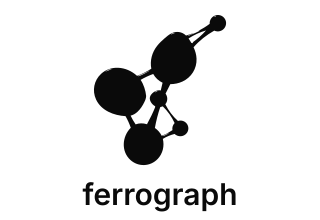

<p align="center">
  
</p>

<p align="center">
  <a href="https://crates.io/crates/ferrograph"></a>
  <a href="https://github.com/GarthDB/ferrograph/actions/workflows/ci.yml"></a>
  <a href="https://github.com/GarthDB/ferrograph/blob/main/LICENSE"></a>
</p>

Graph-powered Rust code intelligence. Indexes Rust codebases into a queryable knowledge graph with CLI and MCP interfaces.

## Status

Implements file discovery, tree-sitter AST extraction (functions, structs, enums, traits, impls, consts, statics, macros, modules), `mod`/`use` resolution with Imports edges, call graph construction (same-file and cross-file via imports; includes calls inside macro invocations such as `format!()` and `println!()`), type reference edges, trait impl edges, Owns and Borrows (`&T`) and BorrowsMut (`&mut T`) edges (syntactic; struct fields, function parameters, and return types), canonical primitive type nodes (e.g. `primitive::i32`) so edges to primitives are retained, unresolved type targets (generics, external crates) as synthetic `ExternalType` nodes (e.g. `external::Vec`), lifetime_scope edges (items with explicit lifetime parameters), macro expansion edges, unsafe usage edges, dead code detection (`pub`, `main`, `#[test]`, and `#[bench]` entry points), CozoDB graph storage, CLI (index, query, search, status, watch), MCP server with 10 tools (`reindex`, `status`, `search`, `node_info`, `dead_code`, `blast_radius`, `callers`, `query`, `trait_implementors`, `module_graph`), and optional git change-coupling analysis. Node IDs are relative to the project root (e.g. `./src/main.rs#10:1`). Full ownership/borrow semantics (move analysis, lifetime validity) are planned for future rust-analyzer integration.

## Build

```bash
cargo build --release
cargo test
cargo clippy -- -D warnings
```

The repository is a Cargo workspace; plain `cargo build`/`test`/`clippy` cover the `ferrograph` crate only. The accuracy harness behind the figures in [Accuracy and limitations](#accuracy-and-limitations) is the `xtask` crate (`cargo xtask --help`, `cargo test -p xtask`; see [`scripts/accuracy/README.md`](scripts/accuracy/README.md)). It is not published.

## Usage

```bash
# Index current directory (in-memory)
cargo run -- index .

# Index to a persistent database
cargo run -- index . --output .ferrograph

# Run Datalog queries (requires a persistent database)
cargo run -- query --db .ferrograph "?[id, type, payload] := *nodes[id, type, payload]"
cargo run -- query --db .ferrograph "?[id] := *dead_functions[id]"

# Text search over node payloads (use -c for case-insensitive)
cargo run -- search --db .ferrograph "main"
cargo run -- search --db .ferrograph -c "greet"

# Show graph stats
cargo run -- status --db .ferrograph

# Watch for changes and re-index (--output/--db required)
cargo run -- watch . --output .ferrograph

# Run MCP server over stdio (for AI agents / IDEs).
# The server looks for a graph at FERROGRAPH_DB or .ferrograph in the current directory.
# Set FERROGRAPH_DB to the path of your index to use a specific graph.
cargo run -- mcp
```

### Selecting the graph

Every query subcommand (`status`, `query`, `search`, `dead`, `blast`, `callers`, `info`, `modules`, `traits`) takes `-d/--db PATH`, either a graph database file or a project directory containing `.ferrograph`. It defaults to `./.ferrograph`. `index` and `watch` keep the positional project root and accept `--db` as an alias of `-o/--output`. For these two, `--db` names the file to **write** and is used as given (no project-directory lookup), so `index --db .` and `status --db .` mean different things.

The positional form `status [PATH]` is deprecated (still works, prints a note on stderr); use `status --db PATH`.

`status` on a missing graph exits 2 with the error on stderr and nothing on stdout (also with `--json`), like the other query subcommands.

### CI gating and exit codes

`dead` and `blast` can fail a CI job when findings exceed a threshold. Flags are opt-in; without them the exit code is unchanged. Because dead-code results are not exact (see [Accuracy and limitations](#accuracy-and-limitations)), try advisory mode on your own repo before gating.

```bash
ferrograph dead --db .ferrograph --max 0      # same as --fail-on-any
ferrograph dead --db .ferrograph --max 25     # allow up to 25 findings
ferrograph blast --db .ferrograph --max 100 "<node id>"
```

Normal output (including `--json`) is printed first and is unchanged; a breach adds one line `threshold exceeded: N > M` on stderr.

| Code | Meaning |
|---|---|
| 0 | OK / no findings over the threshold |
| 1 | Findings over the threshold |
| 2 | Error (bad arguments, missing database, query failure) |

> **Behaviour change:** runtime errors (missing database, query failure) previously exited 1; they now exit 2 so that 1 means "findings over threshold".

### Output formats (`--format`)

`dead`, `pr`, `blast` and `callers` accept `--format text|json|sarif|markdown` (default `text`). `--json` is an alias for `--format json`; combining it with a different `--format` is an error. Text and JSON output are unchanged. Thresholds and exit codes apply in every format, and threshold messages and warnings stay on stderr, so stdout is always a valid document.

- **`sarif`** (`dead`, `pr`): SARIF 2.1.0, one `ferrograph/dead-code` result (level `warning`) per dead / newly dead function, located by repo-relative path (`%SRCROOT%`) and line/column. `partialFingerprints` use path + function name + occurrence index, not the line, so GitHub code scanning does not reopen alerts when lines shift. `blast` and `callers` are impact listings rather than problems, so `--format sarif` is an error there.
- **`markdown`** (all four): a table for a sticky PR comment, starting with the hidden marker `<!-- ferrograph -->` so a CI step can find and update its own comment. Names are escaped; tables show at most `--markdown-limit N` rows (default 50) followed by `... and N more`, and the whole output is cut below GitHub's 65,536-character comment limit.

```yaml
- run: ferrograph dead --db .ferrograph --format sarif > ferrograph.sarif
- uses: github/codeql-action/upload-sarif@v3
  with:
    sarif_file: ferrograph.sarif
# needs: permissions: security-events: write

- run: ferrograph pr --base origin/main --index-head --format markdown > comment.md
# post/update comment.md with a step that looks for the <!-- ferrograph --> marker,
# e.g. marocchino/sticky-pull-request-comment with `path: comment.md`
```

`pr` can write several formats from one run (one index of each tree) with a repeatable `--out FORMAT=PATH`, where `FORMAT` is `json`, `markdown`, `sarif` or `text`:

```
ferrograph pr --base origin/main --index-head --out json=report.json --out markdown=comment.md --out sarif=ferrograph.sarif --max-new-dead 0
```

With `--out` and no `--format`/`--json`, nothing is printed to stdout; with either, stdout is unchanged and the files are extra. Threshold exit codes and warnings are computed once and do not depend on the formats.

### Reviewing a change (`pr`)

`ferrograph pr --base <ref>` reports only what the current branch introduces, so it is intended for CI gating where whole-repo `dead` lists are too noisy. Its accuracy is still being measured (see [Accuracy and limitations](#accuracy-and-limitations)): thresholds (`--fail-on-new-dead`, `--max-*`) are opt-in, so run it in advisory mode on your own repo first and adopt them only once the reports hold up:

- **Newly dead functions**: dead at HEAD but not at the merge base (`became_dead`), or new and never called (`added_dead`). Removed functions are never reported.
- **Impacted by this change**: the transitive callers of each changed function, up to `--impact-depth` hops (default 3), per function and as a de-duplicated union grouped into tests (`tests/` files and `#[test]` functions), examples/benches (`examples/`, `benches/`, `#[bench]`) and library code, with counts and the busiest files (`--blast-limit` caps the listed nodes; `"truncated": true` marks a lower bound). Changed functions themselves are not part of the union. Edges are name-based, so common names (`new`, `build`, `view`) over-count; `--exclude-low-confidence` trims ambiguous edges, and is recommended together with `--max-impacted` (see [Accuracy and limitations](#accuracy-and-limitations): in a hand-labelled sample every false positive came from a low-confidence edge).
- **Tests changed**: changed `#[test]`/`#[bench]` functions are listed separately (`"kind": "test"` / `"bench"` in JSON) with `blast_count: 0` (a semantic change: it is 0 because the closure is not computed, not because it was measured; use `kind` to tell) and are left out of the union, since nothing calls them. Other functions under `examples/` (any path segment named `examples`, `tests` or `benches`, so a library module such as `src/examples/` is matched too, and `examples` wins over `tests`) get `"kind": "example"` and those under `tests/` or `benches/` (helpers such as a shared `view`) get `"kind": "helper"`: tests call them, so they keep their `impacted` set, but they also have `blast_count: 0` (a gallery story or test helper reaches 100+ nodes of unrelated code) and add nothing to the blast union. Their callers stay in the impacted union. A changed function's `impacted` count includes other changed functions; the union does not. `--impact-depth` takes 1-100.
- **Blast radius** (what the changed code *depends on*, not what depends on it: the forward closure plus direct callers) of the changed functions (changed lines mapped to the innermost containing function), per function plus the de-duplicated union (`--blast-limit`, default 200 listed; the full count is always reported, up to an internal cap of 50,000 nodes per function; past it the JSON gets `"truncated": true` and text shows `50000+`). Lines outside any function (`use`, `struct`, `const` edits) are listed separately and add no blast.
- **Coupling hints** (`changes_with` files not touched by the change) when the graph was indexed with the `git` feature; omitted otherwise.

```bash
ferrograph index --output .ferrograph
ferrograph pr --base origin/main --fail-on-new-dead          # exit 1 if any function became dead
ferrograph pr --base origin/main --max-new-dead 2 --max-blast 300 --json
```

GitHub Actions (the base ref must be available, so fetch full history):

```yaml
- uses: actions/checkout@v4
  with:
    fetch-depth: 0
- run: ferrograph index --output .ferrograph
- run: ferrograph pr --base origin/main --fail-on-new-dead
```

Notes:

- The diff is `git diff <base>...HEAD` (from the merge base). The base is indexed in a temporary `git worktree` that is removed on exit, on SIGINT/SIGTERM, and (for a killed run) pruned by the next `pr` run; pass `--base-db PATH` to reuse an already indexed base graph (e.g. from a CI cache). Your working tree is not touched.
- HEAD is read from `--db` (default `./.ferrograph`). A missing or stale graph is an error; pass `--index-head` to index the HEAD commit into memory instead. Uncommitted changes are ignored (a warning is printed); a `--db` graph is assumed to match HEAD, and `--base-db` is assumed to be indexed from the merge base (a warning says so).
- `--strict`, `--restricted-vis-not-root`, `--bin-pub-not-root`, `--entry`, `--ignore` and `.ferrograph.toml` (read from the HEAD commit, for both sides) apply identically to base and head. `--exclude-low-confidence` applies to the impacted set and blast. `--ignore` and `[dead] ignore` also filter the changed-function, changed-lines and impacted lists (a generated file's edits are dropped); `changed_files` stays the raw git list.
- Functions are matched across base and head by file, name and occurrence among same-name functions in the file, not by node id, so shifting line numbers is harmless. A renamed function, or one moved to another file, looks like one removed plus one added; a function inserted above a same-name function in the same file can shift the match. Pure file renames are followed.
- Run it from the project root inside a git repository. Exit codes: 0 ok, 1 threshold breached (`--fail-on-new-dead`, `--max-new-dead`, `--max-impacted` (more than N impacted functions; name-based, so try advisory mode first), `--max-blast`, which gates the "depends on" blast count, not the impacted count), 2 error (including an unknown base ref).

### Setup with Claude Code

A Claude Code skill gives Claude a full workflow for indexing, exploring, and querying ferrograph graphs via the `/ferrograph` slash command.

**Install (any method):**

```bash
# From GitHub (no clone needed)
curl -fsSL https://raw.githubusercontent.com/GarthDB/ferrograph/main/install-claude-skill.sh | sh

# From a local clone
sh install-claude-skill.sh
```

The script writes the skill to `~/.claude/skills/ferrograph/SKILL.md` and patches `~/.claude/CLAUDE.md` automatically.

Once installed, use `/ferrograph <path>` in any Claude Code session to index and explore a Rust project.

> **Coming soon**: `ferrograph claude install` will handle this in a single command with no script required ([#47](https://github.com/GarthDB/ferrograph/issues/47)).

A `CLAUDE.md` in the repo root covers project-specific rules for working on ferrograph itself (Rust standards, commit format, architecture notes).

### Setup with Cursor

Add to `.cursor/mcp.json` in your project (or global settings):

```json
{
  "mcpServers": {
    "ferrograph": {
      "command": "ferrograph",
      "args": ["mcp"],
      "env": {
        "FERROGRAPH_DB": "/absolute/path/to/your/project/.ferrograph"
      }
    }
  }
}
```

If building from source instead of installing via `cargo install ferrograph`:

```json
{
  "mcpServers": {
    "ferrograph": {
      "command": "cargo",
      "args": ["run", "--manifest-path", "/path/to/ferrograph/Cargo.toml", "--", "mcp"],
      "env": {
        "FERROGRAPH_DB": "/absolute/path/to/your/project/.ferrograph"
      }
    }
  }
}
```

### Setup with Claude Desktop

Add to your Claude Desktop config (`~/Library/Application Support/Claude/claude_desktop_config.json` on macOS):

```json
{
  "mcpServers": {
    "ferrograph": {
      "command": "ferrograph",
      "args": ["mcp"],
      "env": {
        "FERROGRAPH_DB": "/absolute/path/to/your/project/.ferrograph"
      }
    }
  }
}
```

### First use

You can either pre-index your project or let the MCP `reindex` tool bootstrap it:

```bash
# Option 1: Pre-index from the CLI
cd /path/to/your/rust/project
ferrograph index . --output .ferrograph

# Option 2: Skip this step — use the reindex MCP tool from your AI agent
```

The `FERROGRAPH_DB` env var is optional if you run the MCP server from the project root (it defaults to `.ferrograph` in the current directory).

### Keeping the graph current

The MCP server keeps an existing graph up to date on its own. Every graph records the project root it was built from and a fingerprint of that project's `.rs` files (paths, sizes and modification times, with the same `.gitignore` rules as indexing). Before answering a tool call the server recomputes the fingerprint for the recorded root, so it does not matter which directory the server was started in. If any file was edited, added, removed or renamed, it reindexes first. The first call after a pull or branch switch therefore takes as long as a reindex. Set `FERROGRAPH_AUTO_REINDEX=0` to turn this off and reindex only on request. Graphs written by ferrograph 1.5.1 or earlier do not record a root; run `reindex` (or `ferrograph index`) once to turn on automatic refresh for them.

`ferrograph index --output`, `ferrograph watch`, the `reindex` tool and the automatic refresh build the graph in memory and replace the database file in one rename. A server or CLI that has the database open is not blocked and never reads a half-written graph; servers reopen the file when it changes, so several agents can share one `.ferrograph`.

The graph is a local build artifact. Add `.ferrograph*` to your `.gitignore`; the pattern also covers the `.ferrograph.tmp-*` file left behind if an index run is killed partway through.

### MCP tools

Node IDs use the format `./path/to/file.rs#line:col` (relative to the project root).

| Tool | Description |
|------|-------------|
| `reindex` | Re-index the project; can bootstrap from scratch (no pre-existing DB needed). |
| `status` | Node/edge counts, DB path, `indexed_at` timestamp, project `root` the graph tracks. |
| `search` | Text search over node payloads; supports limit/offset pagination. |
| `node_info` | Type, payload, and incoming/outgoing edges for a node ID. |
| `dead_code` | Functions not reachable from entry points; optional `node_type` and `file_glob` filters. Ambiguous (low-confidence) call targets count as live; `strict: true` ignores them. |
| `blast_radius` | Forward closure (what the node depends on, plus its direct callers) via calls, references, and changes_with edges; use `callers` for what depends on a node. `exclude_low_confidence: true` skips ambiguous calls. |
| `callers` | Direct and transitive callers up to a given depth. `exclude_low_confidence: true` skips ambiguous calls. |
| `query` | Raw Datalog queries (read-only; mutations rejected). |
| `trait_implementors` | Find the `impl` blocks of a trait declared in the project (substring match on the trait name, at most 500). Traits from other crates (`Display`, `Iterator`) have no node and return nothing. |
| `module_graph` | File-to-module containment edges; optional relative path prefix filter (e.g. `./src/`). |

## CI

[`GarthDB/ferrograph-action`](https://github.com/GarthDB/ferrograph-action) runs `ferrograph pr` on pull requests and posts a sticky comment with newly dead functions and blast radius. Advisory mode is the recommended default today, because dead-code detection has known false positives and negatives (see [Accuracy and limitations](#accuracy-and-limitations)). The action is advisory by default (it fails only if you set `fail-on-new-dead`, `max-new-dead` or `max-blast`) and can upload SARIF to code scanning. `@v2` needs ferrograph v5.0.0 or later (`pr --out`, one run for every report; the 5.0 defaults); `pr` itself exists since v4.0.0, which only the older `@v1` still supports.

```yaml
name: ferrograph
on: pull_request
permissions:
  contents: read
  pull-requests: write   # needed for the PR comment
jobs:
  ferrograph:
    runs-on: ubuntu-latest
    steps:
      - uses: actions/checkout@v4
        with:
          fetch-depth: 0   # required: the base ref must exist
      - uses: GarthDB/ferrograph-action@v2
```

Without `pull-requests: write`, and on pull requests from forks (read-only token), the report goes to the job summary instead of a comment; the job still passes. See the action's README for inputs, thresholds and SARIF.

## Graph schema (edge types)

### Dead-code entry points and ignores

Beyond `main`, `pub`, `#[test]` and `#[bench]`, `ferrograph dead` accepts extra roots and ignores, from flags or a `.ferrograph.toml` next to the database (flags are added to the file's lists):

```toml
[dead]
entry  = ["examples/**", "build.rs", "#[no_mangle]", "#[extern]"]  # file globs or attributes
ignore = ["src/generated/**"]                                       # never reported
restricted_vis_not_root = true                                      # default since 5.0; false restores `pub(crate)` roots, see below
bin_pub_not_root = true                                             # default; false restores bare `pub` roots, see below
```

```bash
ferrograph dead --entry 'examples/**' --entry '#[no_mangle]' --ignore 'src/generated/**'
```

Using `--entry`/`--strict`, or leaving `--restricted-vis-not-root` or `--bin-pub-not-root` on (the defaults), recomputes liveness instead of reading the index-time result; `--no-restricted-vis-not-root` and `--no-bin-pub-not-root` exist to override the config file. The MCP `dead_code` tool accepts `strict`, `restricted_vis_not_root` (default true) and `bin_pub_not_root` (default true), but not entries or ignores.

`--restricted-vis-not-root` (on by default since 5.0; `--no-restricted-vis-not-root` or `restricted_vis_not_root = false` under `[dead]` turns it off, and the CLI flag wins over the config; `dead` and `pr`, applied to both sides of `pr`) stops treating `pub(crate)`, `pub(super)` and `pub(in ..)` functions as roots; bare `pub` stays one. It raises recall a lot (most rustc-dead functions are restricted or bare `pub` in binary crates) at the price of more false positives, because unresolved calls then make live code look dead. It is on by default, except with `--strict`, where it stays off unless passed or set in the config (the extras were 78% false positives with `--strict` on 22 corpora, 0% without); see [#92](https://github.com/GarthDB/ferrograph/issues/92) and [#91](https://github.com/GarthDB/ferrograph/issues/91) for measurements. A graph indexed by an older ferrograph has no visibility marker, so re-index after upgrading.

`--bin-pub-not-root` (on by default since 5.0; `--no-bin-pub-not-root` or `bin_pub_not_root = false` under `[dead]` turns it off, and the CLI flag wins over the config; `dead` and `pr`, applied to both sides of `pr`) stops treating bare `pub` functions as roots in files that only bin, test, example, bench or build-script targets compile: nothing outside the binary can call them, and rustc reports them. "Bin-only" is read from Cargo's target layout at index time: `tests/`, `examples/`, `benches/`, `build.rs`, `src/main.rs` and `src/bin/` always, and every other file of a package that has no library target (no `src/lib.rs`, no `[lib]`). Files of a package that also has a library, and files outside any `Cargo.toml`, stay roots. It composes with `--restricted-vis-not-root` (which covers `pub(crate)` in the same files). A fn that only some test targets use is not reported, because liveness is the union over targets. It is on by default, except with `--strict` (same rule as above); see [#92](https://github.com/GarthDB/ferrograph/issues/92) for measurements. Re-index after upgrading: older graphs have no marker (`pr` warns when only one of the base and head graphs has it, e.g. a `--base-db` from an older version).

The schema defines 12 edge types; all 12 are currently populated:

| Edge type           | v1 populated | Notes |
|---------------------|-------------|-------|
| `contains`          | Yes         | File/module containment. |
| `imports`           | Yes         | From `mod`/`use` resolution. |
| `calls`             | Yes         | Same-file and cross-file (via imports) calls, plus fns used as values (`map(f)`, fn-pointer args/fields). Ambiguous name matches become one edge per candidate with a confidence (1/N) in the `edge_confidence` relation; `dead --strict`, `blast --exclude-low-confidence` and `callers --exclude-low-confidence` ignore them. |
| `references`        | Yes         | Type mentions in fields, params, return types. |
| `implements_trait`  | Yes         | Trait impls (`impl Trait for Type`). |
| `owns`              | Yes         | Struct fields and fn params; unresolvable types (primitives, generics, external) omitted. |
| `borrows`           | Yes         | Struct fields and fn params (`&T`/`&mut T`); same resolution limits as owns. |
| `expands_to`        | Yes         | Macro invocation to macro definition. |
| `uses_unsafe`       | Yes         | Unsafe blocks and `unsafe fn`/`unsafe impl`. |
| `lifetime_scope`    | Yes         | Self-loop on items with explicit lifetime params (tree-sitter only). |
| `has_attribute`     | Yes         | Function to synthetic `attr::<name>` target per outer attribute (e.g. `attr::no_mangle`, `attr::extern`). Used for `dead` entry points. |
| `changes_with`      | Yes (requires `git` feature) | Git change coupling (optional feature). |

## Accuracy and limitations

Dead-code and blast-radius results are a review aid, not proof.

- **What is analysed**: syntactic (tree-sitter) extraction with name-based call resolution. Ambiguous names become low-confidence edges, which `--strict` (and `--exclude-low-confidence`) ignore.
- **Always live**: all `pub` items (by default only bare `pub`: `pub(crate)`/`pub(super)` are ordinary candidates, and bare `pub` in bin/test/example/bench-only files is a candidate too; `--no-restricted-vis-not-root` and `--no-bin-pub-not-root` restore them as roots), functions named `_something` (rustc never reports them, and what they call stays live), trait impl methods, methods of an inherent `impl` carrying an attribute macro (`#[zbus::interface]`; `cfg`, `allow`, `inline`, `doc` and similar do not count), entry attributes, `main`, and test code.
- **Known false positives** (live code reported dead): names used only in attribute or macro arguments ([#89](https://github.com/GarthDB/ferrograph/issues/89)), consts and statics inside an attribute-macro impl, some cross-file qualified paths, methods above the 8-candidate cap, and `dyn Trait` dynamic dispatch.
- **Known false negatives** (dead code not reported): anything bare `pub` outside bin-only files (and `pub(crate)` with `--no-restricted-vis-not-root`), trait impls, and name collisions ([#91](https://github.com/GarthDB/ferrograph/issues/91)).
- **Recall** (22 pinned corpora, 140 functions that rustc reports dead in every compilation unit; Wilson 95% intervals; one platform, so code under a `cfg` for another platform counts as dead for rustc but live for ferrograph; measured on v6.1.0): with both visibility rules off (the 4.x behaviour) 17.1% [11.8-24.2], `--restricted-vis-not-root` alone 29.3%, both on (the default since 5.0) 50.0% [41.8-58.2]. The default adds 95 reports over the 4.x behaviour and loses none: 46 confirmed by rustc, 44 in `#[cfg]` code rustc cannot judge, 5 that rustc does not confirm (9.8% of the 51 judgeable extras, interval 4.3-21.0%; two are in dust's `platform.rs`, two are test-support helpers that some test targets still use, one is govee2mqtt's `publish_config`). With `--strict`, turning the same two rules on adds 336 reports, and 67% of the 156 judgeable ones are false positives (104), which is why `--strict` leaves both rules off unless asked. Of the 70 misses at the default, 47 are kept alive by a call edge (34 of them in `topgrade`: 33 are reached only from code under `cfg` for another platform, which rustc does not compile on the measuring platform, and 1 is a name collision with `tempfile`'s `.path()`) and 23 by bare `pub` roots (items of library crates). See [#91](https://github.com/GarthDB/ferrograph/issues/91), [#92](https://github.com/GarthDB/ferrograph/issues/92) and `scripts/accuracy/README.md`.
- **Precision** (same 22 corpora, default mode, 5.0 defaults): of 156 reported functions, 70 are confirmed by rustc, 5 are not, and 81 are in `#[cfg]` code or files rustc did not compile on the measuring platform and cannot be judged: 93.3% (70/75) precision on the judgeable reports, interval 85.3-97.1%, but only 48% of reports are judgeable. Earlier versions measured far lower (about 1 true-dead in 45 sampled reports in v4.0.4, [#92](https://github.com/GarthDB/ferrograph/issues/92)); the false-positive classes behind that have since been fixed. Treat the list as a review aid, and expect a human check for reports under `#[cfg]`.

- **Impacted-set precision** (`pr`, hand-labelled; spectrum-rune PRs #47, #49, #50, 67 impacted functions in all; measured on v6.1.0; Wilson 95% intervals): a node counts as correct when every call hop back to a changed function resolves to the right function. By depth (cumulative, default mode): depth 1 75.0% (21/28) [56.6-87.3], up to depth 2 83.3% (35/42) [69.4-91.7], up to depth 3 89.5% (60/67) [80.0-94.8]. All 7 false positives are depth-1 nodes that exist only through low-confidence edges (`.width()`, `.options()`, `.variant()` on a different type matched to a changed same-named method); with `--exclude-low-confidence` every depth is 100% (60/60) [94.0-100.0]. The nodes added at depth 2 (14) and depth 3 (25) were all correct, so depth does not compound the error here. The sample is small, comes from one repo and mostly from #47 (the only PR with low-confidence edges); it measures precision only, and some real callers are missed (a `.build(t)` call chain did not link to a changed `build`). Labels and raw output: `scripts/accuracy/impact/`.

- **Does `--exclude-low-confidence` drop real callers?** Yes, so it stays opt-in ([#187](https://github.com/GarthDB/ferrograph/issues/187)). Low-confidence edges link a call to every same-named candidate (confidence 1/N), so when the receiver type is unknown the one real call is dropped along with the wrong ones. Minimal case: `fn render<T: Draw>(t: &T) { t.draw() }` with two `impl Draw` blocks. Change one `draw`: the default report lists `render` and `main`, `--exclude-low-confidence` lists nothing. A second sample (6 ferrograph commits, 18 nodes only reachable through low-confidence edges, hand-labelled in `scripts/accuracy/impact-self/lowconf-only.csv`) found all 18 false (external `BTreeMap::new`, `DbInstance::new`, a local closure named like a changed fn); with the spectrum-rune 7 that is 0 of 25 real, but that figure is not evidence the flag is safe: the sample contains only nodes already known to be low-confidence-only, so it can produce false positives and nothing else, and both samples are name collisions that cannot see trait or generic dispatch. The only measurement of real callers lost is the fixture above (pinned by `exclude_low_confidence_drops_trait_dispatch_callers` in `tests/integration_pr.rs`); recall on a corpus was not measured. Use the flag where false positives cost more than missed callers (a `--max-impacted` gate); for a blast-radius review, read the default list.

## Publishing

Published to [crates.io](https://crates.io/crates/ferrograph). Releases are cut by [release-plz](https://release-plz.dev): merging its release PR publishes the crate, tags `vX.Y.Z` and attaches the binaries (`ferrograph-<target>.tar.gz`, `SHA256SUMS`) to the GitHub release. `Cargo.toml` pins rayon to `>=1.5, <1.11` because cozo's transitive `graph_builder` 0.4.1 is incompatible with rayon 1.11+. This pin does not affect end users.

See [CHANGELOG.md](CHANGELOG.md) for version history.

## License

MIT
