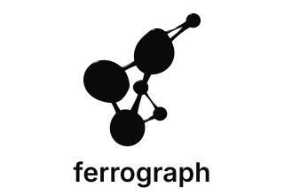

<p align="center">
  
</p>

<p align="center">
  <a href="https://crates.io/crates/ferrograph"></a>
  <a href="https://github.com/GarthDB/ferrograph/actions/workflows/ci.yml"></a>
  <a href="https://github.com/GarthDB/ferrograph/blob/main/LICENSE"></a>
</p>

Graph-powered Rust code intelligence. Indexes Rust codebases into a queryable knowledge graph with CLI and MCP interfaces.

## Status

Implements file discovery, tree-sitter AST extraction (functions, structs, enums, traits, impls, consts, statics, macros, modules), `mod`/`use` resolution with Imports edges, call graph construction (same-file and cross-file via imports; includes calls inside macro invocations such as `format!()` and `println!()`), type reference edges, trait impl edges, Owns and Borrows (`&T`) and BorrowsMut (`&mut T`) edges (syntactic; struct fields, function parameters, and return types), canonical primitive type nodes (e.g. `primitive::i32`) so edges to primitives are retained, unresolved type targets (generics, external crates) as synthetic `ExternalType` nodes (e.g. `external::Vec`), lifetime_scope edges (items with explicit lifetime parameters), macro expansion edges, unsafe usage edges, dead code detection (`pub`, `main`, `#[test]`, and `#[bench]` entry points), CozoDB graph storage, CLI (index, query, search, status, watch), MCP server with 10 tools (`reindex`, `status`, `search`, `node_info`, `dead_code`, `blast_radius`, `callers`, `query`, `trait_implementors`, `module_graph`), and optional git change-coupling analysis. Node IDs are relative to the project root (e.g. `./src/main.rs#10:1`). Full ownership/borrow semantics (move analysis, lifetime validity) are planned for future rust-analyzer integration.

## Build

```bash
cargo build --release
cargo test
cargo clippy -- -D warnings
```

## Usage

```bash
# Index current directory (in-memory)
cargo run -- index .

# Index to a persistent database
cargo run -- index . --output .ferrograph

# Run Datalog queries (requires a persistent database)
cargo run -- query --db .ferrograph "?[id, type, payload] := *nodes[id, type, payload]"
cargo run -- query --db .ferrograph "?[id] := *dead_functions[id]"

# Text search over node payloads (use -c for case-insensitive)
cargo run -- search --db .ferrograph "main"
cargo run -- search --db .ferrograph -c "greet"

# Show graph stats
cargo run -- status --db .ferrograph

# Watch for changes and re-index (--output/--db required)
cargo run -- watch . --output .ferrograph

# Run MCP server over stdio (for AI agents / IDEs).
# The server looks for a graph at FERROGRAPH_DB or .ferrograph in the current directory.
# Set FERROGRAPH_DB to the path of your index to use a specific graph.
cargo run -- mcp
```

### Selecting the graph

Every query subcommand (`status`, `query`, `search`, `dead`, `blast`, `callers`, `info`, `modules`, `traits`) takes `-d/--db PATH`, either a graph database file or a project directory containing `.ferrograph`. It defaults to `./.ferrograph`. `index` and `watch` keep the positional project root and accept `--db` as an alias of `-o/--output`. For these two, `--db` names the file to **write** and is used as given (no project-directory lookup), so `index --db .` and `status --db .` mean different things.

The positional form `status [PATH]` is deprecated (still works, prints a note on stderr); use `status --db PATH`.

### CI gating and exit codes

`dead` and `blast` can fail a CI job when findings exceed a threshold. Flags are opt-in; without them the exit code is unchanged.

```bash
ferrograph dead --db .ferrograph --max 0      # same as --fail-on-any
ferrograph dead --db .ferrograph --max 25     # allow up to 25 findings
ferrograph blast --db .ferrograph --max 100 "<node id>"
```

Normal output (including `--json`) is printed first and is unchanged; a breach adds one line `threshold exceeded: N > M` on stderr.

| Code | Meaning |
|---|---|
| 0 | OK / no findings over the threshold |
| 1 | Findings over the threshold |
| 2 | Error (bad arguments, missing database, query failure) |

> **Behaviour change:** runtime errors (missing database, query failure) previously exited 1; they now exit 2 so that 1 means "findings over threshold".

### Output formats (`--format`)

`dead`, `pr`, `blast` and `callers` accept `--format text|json|sarif|markdown` (default `text`). `--json` is an alias for `--format json`; combining it with a different `--format` is an error. Text and JSON output are unchanged. Thresholds and exit codes apply in every format, and threshold messages and warnings stay on stderr, so stdout is always a valid document.

- **`sarif`** (`dead`, `pr`): SARIF 2.1.0, one `ferrograph/dead-code` result (level `warning`) per dead / newly dead function, located by repo-relative path (`%SRCROOT%`) and line/column. `partialFingerprints` use path + function name + occurrence index, not the line, so GitHub code scanning does not reopen alerts when lines shift. `blast` and `callers` are impact listings rather than problems, so `--format sarif` is an error there.
- **`markdown`** (all four): a table for a sticky PR comment, starting with the hidden marker `<!-- ferrograph -->` so a CI step can find and update its own comment. Names are escaped; tables show at most `--markdown-limit N` rows (default 50) followed by `... and N more`, and the whole output is cut below GitHub's 65,536-character comment limit.

```yaml
- run: ferrograph dead --db .ferrograph --format sarif > ferrograph.sarif
- uses: github/codeql-action/upload-sarif@v3
  with:
    sarif_file: ferrograph.sarif
# needs: permissions: security-events: write

- run: ferrograph pr --base origin/main --index-head --format markdown > comment.md
# post/update comment.md with a step that looks for the <!-- ferrograph --> marker,
# e.g. marocchino/sticky-pull-request-comment with `path: comment.md`
```

### Reviewing a change (`pr`)

`ferrograph pr --base <ref>` reports only what the current branch introduces, so it can gate CI where whole-repo `dead` lists are too noisy:

- **Newly dead functions**: dead at HEAD but not at the merge base (`became_dead`), or new and never called (`added_dead`). Removed functions are never reported.
- **Blast radius** of the changed functions (changed lines mapped to the innermost containing function), per function plus the de-duplicated union (`--blast-limit`, default 200 listed; the full count is always reported, up to an internal cap of 50,000 nodes per function; past it the JSON gets `"truncated": true` and text shows `50000+`). Lines outside any function (`use`, `struct`, `const` edits) are listed separately and add no blast.
- **Coupling hints** (`changes_with` files not touched by the change) when the graph was indexed with the `git` feature; omitted otherwise.

```bash
ferrograph index --output .ferrograph
ferrograph pr --base origin/main --fail-on-new-dead          # exit 1 if any function became dead
ferrograph pr --base origin/main --max-new-dead 2 --max-blast 300 --json
```

GitHub Actions (the base ref must be available, so fetch full history):

```yaml
- uses: actions/checkout@v4
  with:
    fetch-depth: 0
- run: ferrograph index --output .ferrograph
- run: ferrograph pr --base origin/main --fail-on-new-dead
```

Notes:

- The diff is `git diff <base>...HEAD` (from the merge base). The base is indexed in a temporary `git worktree` that is always removed; pass `--base-db PATH` to reuse an already indexed base graph (e.g. from a CI cache). Your working tree is not touched.
- HEAD is read from `--db` (default `./.ferrograph`). A missing or stale graph is an error; pass `--index-head` to index the HEAD commit into memory instead. Uncommitted changes are ignored (a warning is printed); a `--db` graph is assumed to match HEAD, and `--base-db` is assumed to be indexed from the merge base (a warning says so).
- `--strict`, `--entry`, `--ignore` and `.ferrograph.toml` (read from the HEAD commit, for both sides) apply identically to base and head. `--exclude-low-confidence` applies to blast.
- Functions are matched across base and head by file, name and occurrence among same-name functions in the file, not by node id, so shifting line numbers is harmless. A renamed function, or one moved to another file, looks like one removed plus one added; a function inserted above a same-name function in the same file can shift the match. Pure file renames are followed.
- Run it from the project root inside a git repository. Exit codes: 0 ok, 1 threshold breached (`--fail-on-new-dead`, `--max-new-dead`, `--max-blast`), 2 error (including an unknown base ref).

### Setup with Claude Code

A Claude Code skill gives Claude a full workflow for indexing, exploring, and querying ferrograph graphs via the `/ferrograph` slash command.

**Install (any method):**

```bash
# From GitHub (no clone needed)
curl -fsSL https://raw.githubusercontent.com/GarthDB/ferrograph/main/install-claude-skill.sh | sh

# From a local clone
sh install-claude-skill.sh
```

The script writes the skill to `~/.claude/skills/ferrograph/SKILL.md` and patches `~/.claude/CLAUDE.md` automatically.

Once installed, use `/ferrograph <path>` in any Claude Code session to index and explore a Rust project.

> **Coming soon**: `ferrograph claude install` will handle this in a single command with no script required ([#47](https://github.com/GarthDB/ferrograph/issues/47)).

A `CLAUDE.md` in the repo root covers project-specific rules for working on ferrograph itself (Rust standards, commit format, architecture notes).

### Setup with Cursor

Add to `.cursor/mcp.json` in your project (or global settings):

```json
{
  "mcpServers": {
    "ferrograph": {
      "command": "ferrograph",
      "args": ["mcp"],
      "env": {
        "FERROGRAPH_DB": "/absolute/path/to/your/project/.ferrograph"
      }
    }
  }
}
```

If building from source instead of installing via `cargo install ferrograph`:

```json
{
  "mcpServers": {
    "ferrograph": {
      "command": "cargo",
      "args": ["run", "--manifest-path", "/path/to/ferrograph/Cargo.toml", "--", "mcp"],
      "env": {
        "FERROGRAPH_DB": "/absolute/path/to/your/project/.ferrograph"
      }
    }
  }
}
```

### Setup with Claude Desktop

Add to your Claude Desktop config (`~/Library/Application Support/Claude/claude_desktop_config.json` on macOS):

```json
{
  "mcpServers": {
    "ferrograph": {
      "command": "ferrograph",
      "args": ["mcp"],
      "env": {
        "FERROGRAPH_DB": "/absolute/path/to/your/project/.ferrograph"
      }
    }
  }
}
```

### First use

You can either pre-index your project or let the MCP `reindex` tool bootstrap it:

```bash
# Option 1: Pre-index from the CLI
cd /path/to/your/rust/project
ferrograph index . --output .ferrograph

# Option 2: Skip this step — use the reindex MCP tool from your AI agent
```

The `FERROGRAPH_DB` env var is optional if you run the MCP server from the project root (it defaults to `.ferrograph` in the current directory).

### Keeping the graph current

The MCP server keeps an existing graph up to date on its own. Every graph records the project root it was built from and a fingerprint of that project's `.rs` files (paths, sizes and modification times, with the same `.gitignore` rules as indexing). Before answering a tool call the server recomputes the fingerprint for the recorded root, so it does not matter which directory the server was started in. If any file was edited, added, removed or renamed, it reindexes first. The first call after a pull or branch switch therefore takes as long as a reindex. Set `FERROGRAPH_AUTO_REINDEX=0` to turn this off and reindex only on request. Graphs written by ferrograph 1.5.1 or earlier do not record a root; run `reindex` (or `ferrograph index`) once to turn on automatic refresh for them.

`ferrograph index --output`, `ferrograph watch`, the `reindex` tool and the automatic refresh build the graph in memory and replace the database file in one rename. A server or CLI that has the database open is not blocked and never reads a half-written graph; servers reopen the file when it changes, so several agents can share one `.ferrograph`.

The graph is a local build artifact. Add `.ferrograph*` to your `.gitignore`; the pattern also covers the `.ferrograph.tmp-*` file left behind if an index run is killed partway through.

### MCP tools

Node IDs use the format `./path/to/file.rs#line:col` (relative to the project root).

| Tool | Description |
|------|-------------|
| `reindex` | Re-index the project; can bootstrap from scratch (no pre-existing DB needed). |
| `status` | Node/edge counts, DB path, `indexed_at` timestamp, project `root` the graph tracks. |
| `search` | Text search over node payloads; supports limit/offset pagination. |
| `node_info` | Type, payload, and incoming/outgoing edges for a node ID. |
| `dead_code` | Functions not reachable from entry points; optional `node_type` and `file_glob` filters. Ambiguous (low-confidence) call targets count as live; `strict: true` ignores them. |
| `blast_radius` | Transitive impact set via calls, references, and changes_with edges. `exclude_low_confidence: true` skips ambiguous calls. |
| `callers` | Direct and transitive callers up to a given depth. `exclude_low_confidence: true` skips ambiguous calls. |
| `query` | Raw Datalog queries (read-only; mutations rejected). |
| `trait_implementors` | Find implementations of a named trait (stub; returns empty with note). |
| `module_graph` | File-to-module containment edges; optional relative path prefix filter (e.g. `./src/`). |

## Graph schema (edge types)

### Dead-code entry points and ignores

Beyond `main`, `pub`, `#[test]` and `#[bench]`, `ferrograph dead` accepts extra roots and ignores, from flags or a `.ferrograph.toml` next to the database (flags are added to the file's lists):

```toml
[dead]
entry  = ["examples/**", "build.rs", "#[no_mangle]", "#[extern]"]  # file globs or attributes
ignore = ["src/generated/**"]                                       # never reported
```

```bash
ferrograph dead --entry 'examples/**' --entry '#[no_mangle]' --ignore 'src/generated/**'
```

Using `--entry`/`--strict` recomputes liveness instead of reading the index-time result. Not yet applied by the MCP `dead_code` tool.

The schema defines 12 edge types; all 12 are currently populated:

| Edge type           | v1 populated | Notes |
|---------------------|-------------|-------|
| `contains`          | Yes         | File/module containment. |
| `imports`           | Yes         | From `mod`/`use` resolution. |
| `calls`             | Yes         | Same-file and cross-file (via imports) calls, plus fns used as values (`map(f)`, fn-pointer args/fields). Ambiguous name matches become one edge per candidate with a confidence (1/N) in the `edge_confidence` relation; `dead --strict`, `blast --exclude-low-confidence` and `callers --exclude-low-confidence` ignore them. |
| `references`        | Yes         | Type mentions in fields, params, return types. |
| `implements_trait`  | Yes         | Trait impls (`impl Trait for Type`). |
| `owns`              | Yes         | Struct fields and fn params; unresolvable types (primitives, generics, external) omitted. |
| `borrows`           | Yes         | Struct fields and fn params (`&T`/`&mut T`); same resolution limits as owns. |
| `expands_to`        | Yes         | Macro invocation to macro definition. |
| `uses_unsafe`       | Yes         | Unsafe blocks and `unsafe fn`/`unsafe impl`. |
| `lifetime_scope`    | Yes         | Self-loop on items with explicit lifetime params (tree-sitter only). |
| `has_attribute`     | Yes         | Function to synthetic `attr::<name>` target per outer attribute (e.g. `attr::no_mangle`, `attr::extern`). Used for `dead` entry points. |
| `changes_with`      | Yes (requires `git` feature) | Git change coupling (optional feature). |

## Publishing

Published to [crates.io](https://crates.io/crates/ferrograph). `Cargo.toml` pins rayon to `>=1.5, <1.11` because cozo's transitive `graph_builder` 0.4.1 is incompatible with rayon 1.11+. This pin does not affect end users.

See [CHANGELOG.md](CHANGELOG.md) for version history.

## License

MIT
